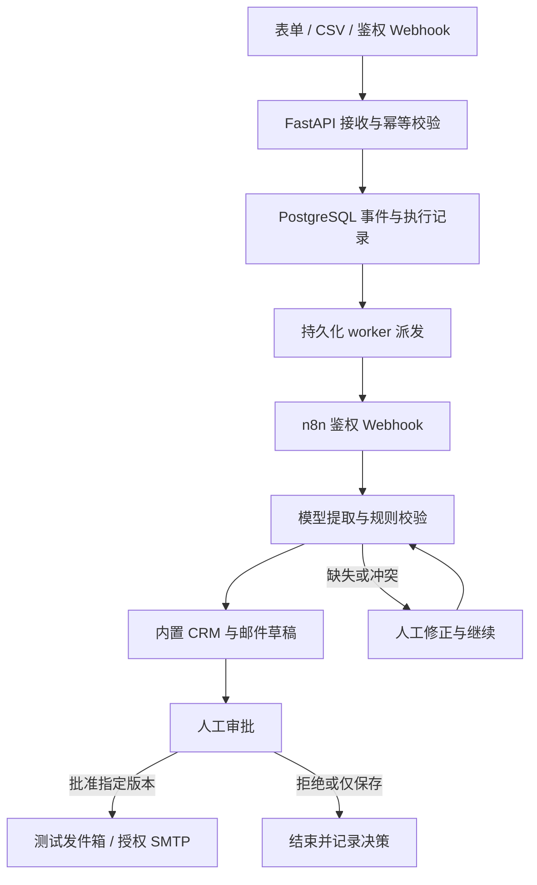

# 架构、业务规则与错误恢复 / Architecture and recovery

## 1. 边界与职责

FlowPilot 第一版是一个固定业务工作流。n8n 负责真实编排、条件分支和 HTTP 节点执行；FastAPI 负责输入、模型适配、规则、持久化动作和权限；后台 worker 负责可靠派发、重试与失联恢复。React 只消费 API 状态，不在浏览器模拟成功结果。

n8n 入口使用随包的自定义 Webhook 触发器：先用加密 Header Auth 凭据做恒定时间校验，再只输出 run_id、phase、dispatch_token。认证头不会进入执行数据；原生节点元数据和终态仍可保存。该扩展通过 n8n 支持的 custom node 加载机制安装，无须修改引擎文件。

n8n HTTP 节点调用 `/api/internal/executions/{id}/steps/{step}`。`extract` 和 `draft` 节点通过真正的模型 Adapter 发起请求，使用 Pydantic / JSON Schema 验证结果。将模型调用封装在后端，使 n8n 无需保存客户原文或模型密钥，也能对同一节点实施幂等和错误归类。这是 n8n 在执行模型业务模块，不是一张展示用流程图。

## 2. 数据实体

| 实体 | 责任 | 关键约束 |
| --- | --- | --- |
| Event / IntakeKey | 原始输入、规范化指纹、幂等键、修订号 | 同一指纹复用事件；同一键不可指向另一内容 |
| Execution | 工作流阶段、尝试、租约、派发令牌、n8n ID / 原生状态 | 新旧派发隔离；过期回调不能推进新执行 |
| NodeRun | 节点开始/结束、耗时、尝试次数、错误和结果 | 每 execution + step 唯一；重复成功节点复用结果 |
| Company / Contact | 归一公司名、规范化邮箱/电话 | 测试与真实记录有独立唯一性范围 |
| Lead / Task | 业务分类、优先级、负责人和跟进任务 | 每事件最多一个内置 CRM 线索和一个任务 |
| Approval | 草稿文本、收件人、版本、决策、授权 | 只有 pending 可编辑；决策须匹配版本 |
| Outbox | 审批快照、投递方式、唯一 Message-ID、投递结果 | 每 approval 最多一条动作记录 |
| Audit / Setting | 审计轨迹、加密后的集成配置 | 返回设置不含明文 Key；审计不复制请求认证头 |

生产交付使用 PostgreSQL。SQLite 仅用于快速开发和某些自动化测试。首次初始化用 SQLAlchemy 创建表；当前未交付历史生产版本的迁移体系，后续字段演进需添加明确迁移。不要把 `create_all()` 当作数据库升级工具。

## 3. 分类规则

当前策略版本 `lead-policy-1.0` 在 `backend/app/rules.py` 定义，可以通过代码审查和版本控制调整。

| 条件 | 结果 |
| --- | --- |
| 缺少姓名、公司或有效邮箱 | 进入人工复核 |
| 需求短于 8 个字符、提取置信度 < 0.70、有歧义或 intent unknown | 进入人工复核 |
| 预算缺失 | 保留 null，添加 `budget_needed`；不编造预算 |
| 销售询价达到所属币种预算阈值，或明确紧急 | 高优先级、重点客户队列 |
| 普通销售询价 | 正常优先级、销售队列 |
| 售后咨询 | 客户成功队列；明确紧急时高优先级 |
| 合作咨询 | 商务合作队列 |
| 无关咨询 | 归档为不合格线索，不生成销售邮件 |

预算阈值为 CNY 100,000；USD 20,000；EUR 20,000；GBP 15,000；AUD 25,000。这些是演示公司自己设定的业务阈值，**不是汇率换算**。模型可以提取意图和紧急程度，但不能写入最终优先级、替代审批、授权外发或绕过顺序校验。

置信度是模型输出的自评字段，不是经过校准的成功概率。真实业务需要用人工标注集测量字段准确率、分类混淆和需要复核的比例。

## 4. 两层执行状态

业务状态包括 `queued`、`running`、`retrying`、`needs_review`、`waiting_approval`、`succeeded`、`rejected`、`failed`。

n8n 的原生状态单独记录。管线在提交 Approval 后正常结束，此时业务状态为 `waiting_approval`；这不代表 n8n 存在原生 Wait 节点。审批后的 delivery 阶段有新的 n8n execution ID。回调证明某个真实节点到达/完成，原生终态由 n8n Public API 对账。未配置 API Key、记录被清理或 API 无法访问时，界面保留 unknown/已观测状态，不把业务状态伪装成 n8n 终态。

## 5. 幂等与恢复

### 接收层

输入先通过 Pydantic 校验，再计算稳定指纹并尝试持久化。非法输入不会先污染 CRM。数据库唯一约束是最终防线；客户端重复点击和上游至少一次投递不会导致同一事件重复入库。相同客户的新消息有不同指纹，允许创建新的事件并复用 Contact。

### 调度层

worker 认领有到期时间的工作，写入租约和派发令牌。调用 n8n 失败时保留失败原因，按限定次数重试。服务重启后读取数据库，不依赖进程内任务队列。租约到期可以重新派发；旧令牌、旧修订或另一个 n8n execution 的回调不能替当前任务提交结果。

### 节点层

每个节点先检查顺序、派发身份和已有成功结果。模型输出必须满足结构化契约；可重试的超时、限流和临时网络错误有上限。验证失败不被转换成“成功的默认答案”。CRM 的联系人/公司/线索/任务更新和节点提交在事务中，重复调用可复用业务结果。

n8n HTTP 节点还有有限重试，用于请求或临时服务失败。最终错误调用后端 failure 接口后进入 Stop And Error，让 n8n 原生执行也失败。后端保存自己已经知道的具体错误；错误分支不上传原始请求头或完整网络异常正文。

### 人工修正与审批层

人工修正提取字段会记录理由和修订，废止旧的待审批草稿，再重新运行后续规则和动作。审批使用 `expected_version` 进行乐观并发控制，避免第二个打开的页面批准过时文本。拒绝和仅保存都是完整的业务结局，不会投递。

### 投递层

测试发件箱是一个真实数据库动作，审批 ID 的唯一约束防止重复条目。SMTP 要求单次动作明确外发授权，且不允许 `is_test=true` 事件外发。邮件使用稳定 Message-ID 便于核对；SMTP 本身不提供通用幂等键。遇到不确定投递结果时不能直接重放，应检查发送服务器记录和对方实际接收情况，再由操作人员决定后续动作。

## 6. 扩展位置

CRM Adapter、模型 Adapter、接收 schema 和工作流步骤保持分层。接入 HubSpot 或 GoHighLevel 时，需要实现认证、字段映射、远端 ID、限流/错误归类以及每个远端动作的幂等策略。文档、票据、工单和 ERP 场景应新增独立 schema/策略/工作流与验收集合；不应把任意工具调用直接赋予模型后声称这些业务已经完成。

## English synopsis

The database is the durable source of business state; n8n owns visual orchestration and reports real execution IDs. Model adapters extract facts and draft text, while code determines routing, priority and approval requirements. Intake keys, normalized identities, step records, versioned approvals and unique delivery actions provide separate idempotency boundaries. Leases and fencing prevent stale workers from committing over a newer dispatch. Native n8n state is reconciled separately from business approval state. SMTP ambiguity is preserved for reconciliation rather than blindly retried.
